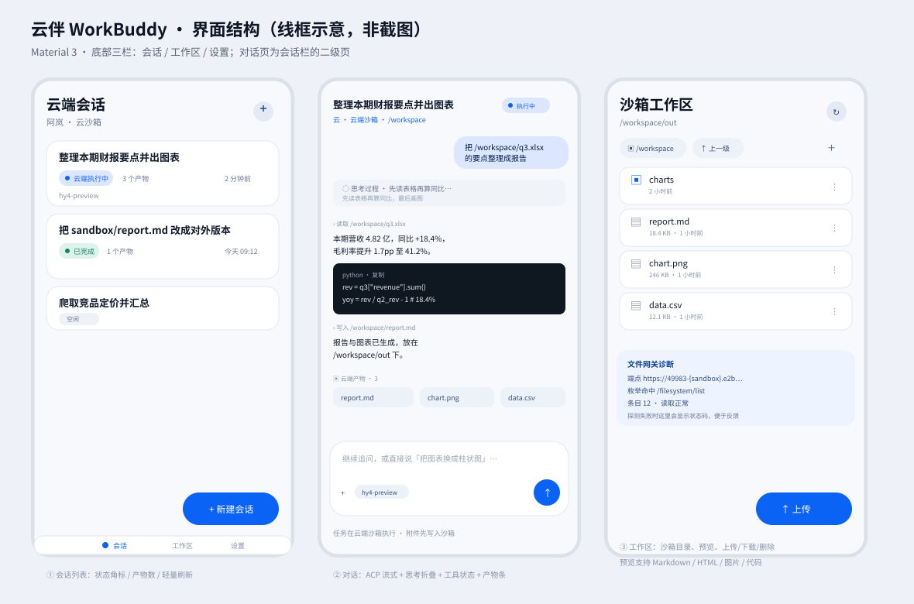

# 云伴 WorkBuddy · 第三方 Android 客户端

一个直接对接 WorkBuddy 官方云端会话协议的安卓客户端。**它不是把模型能力「反代」成本地 API 的壳子**：每一次对话仍然落在官方的云端沙箱里执行，客户端负责的是登录、ACP 事件流、以及沙箱 `/workspace` 的浏览与取回。

界面信息架构参考 [Agents Anywhere](https://github.com/anywhere-labs/Agents-Anywhere) 的安卓端（Kotlin + Jetpack Compose + Material 3，会话 / 工作区 / 设置三栏），协议层参考 [Wearbuddy](https://github.com/Oride-it/Wearbuddy) 对 WorkBuddy 云端接口的复原。

```
登录（手机号 + 短信）
   └── console 网关（cookie 会话）
         ├── 会话列表 / 新建 / 重命名 / 删除
         ├── 模型列表（ACP session/load 的 availableModels 为主，/console/enterprises/{id}/models 为辅）
         ├── 积分额度（/billing/meter/*）
         └── 会话接入点（link + token）
               ├── ACP 长连接（SSE + JSON-RPC 2.0）→ 流式输出、思考、工具、产物
               └── 沙箱文件网关（49983 端口 / E2B envd）→ /workspace 浏览、预览、上传、下载
```

## 为什么强调「保留云端工作区」

很多第三方客户端只截取了 `session/prompt` 这一层，把 WorkBuddy 当成一个 OpenAI 兼容端点喂给本地 agent，结果丢掉了官方产品的核心语义：

| 反代做法 | 本客户端 |
| --- | --- |
| 只取模型输出，本地执行 | 任务在官方 E2B 沙箱里执行，`cwd=/workspace` |
| 文件落在手机本地 | 产物在沙箱内，可浏览、预览、下载、上传 |
| 状态靠猜（无 stopReason） | 用 `session/endTurn`、`state_update`、`stopReason` 判定 |
| 无 askuser 交互 | 云端提问可直接在会话里回答 |

因此这里维护的是「会话连接 + 沙箱文件系统」两套状态，而不是一次性的 HTTP 调用。



> 用 AI 编码工具打开这个仓库时，先读 **[AGENTS.md](AGENTS.md)**：里面有构建命令、
> 版本号规则、以及十五个踩过的坑。各工具的适配文件（`CLAUDE.md`、`.github/copilot-instructions.md`、
> `.cursor/rules/`）都指向它这一份真源。

## 功能

- **登录**：原生 auth-v2 短信链路，SSO 静默续期；凭据（网关 `session` + Keycloak cookie）只存本机。
- **会话**：列表、状态角标、新建、重命名、删除；20 秒轻量刷新。
- **对话**：ACP 流式输出，中间步骤自动归组，最终回答完整保留。
- **提问与确认**：云端停下来问用户时，对话里弹出选择卡片，支持一次多个问题、多选、选项说明和「其他（自行输入）」；权限确认的 `allow_once` 之类机器值会翻译成「允许一次 / 总是允许 / 拒绝一次 / 总是拒绝」。答过的选择会作为一条用户消息留在对话里。
- **中间步骤折叠**：一轮对话里的思考、工具调用、过程叙述收进一个摘要行（如「5 个步骤 · 3 次工具调用」）。右上角三点菜单里是一个**开关**，开启后不仅折叠已有的，**之后新产生的步骤也自动折叠**，不必每轮手动点；单独展开某一轮只对本次会话有效。用户提问与最终回答始终可见，长回答可一键复制。
- **积分与签到**：设置页展示积分余额、等级与额度包，支持每日签到与连续签到天数；主页副标题同步显示余额。
- **附件**：选中的文件先写入沙箱 `/workspace/uploads/…`，再把沙箱路径交给 agent（失败时退回内联内容块）。
- **工作区**：按官方 E2B envd 协议（Connect RPC `filesystem.Filesystem/ListDir`）浏览沙箱目录，支持面包屑导航、新建文件夹、上传、删除、下载到本机（存到系统公共 Download 文件夹）。
- **模型选择**：主来源是 ACP `session/load` 下发的 `models.availableModels`，辅以 console 模型配置接口；失败时显示具体原因并提供重试与手动填写模型 ID。
- **预览**：图片、HTML（WebView）、Markdown、纯文本/代码；其他类型提示下载。
- **产物**：`agent://` / `file:///workspace|root/` 链接仍会识别并挂到会话上，产物文件统一在工作区查看（对话页不再单独占一条产物栏）。
- **多账号**：设置页可添加/切换/删除账号，切换即时生效，登录态各自保留。
- **设置**：账号资料、站点、当前模型、积分、主题（跟随系统/浅色/深色）、动态取色、思考过程默认折叠、
  一次渲染多少轮对话（10/20/50/全部）、历史加载超时（60/120/180/300 秒）。
- **关于与更新**：版本号、GitHub 仓库入口，以及「检查更新」——直接读 GitHub Releases
  比对版本（逐段按数字比，`1.0.10 > 1.0.9`），有新版给出发布说明和下载入口。
  网络不通时明确显示「检查失败」，不会伪装成「已是最新」。

## 已构建产物

仓库不保存 APK（`dist/` 在 `.gitignore` 里），安装包从
[Releases](https://github.com/silverwolf-lv9999/CloudBuddy/releases) 下载。
自己构建就用 `scripts/verify.sh`，它会编译、跑单测、验签名并归档到 `dist/`：

```bash
bash scripts/verify.sh           # 正式包（release），归档 dist/CloudBuddy-<版本>-release.apk
bash scripts/verify.sh --debug   # 需要 debug 包时
```

当前版本 1.4.3（versionCode 27），4096 位 RSA 正式密钥签名，有效期到 2054 年。
签名指纹（后续版本必须一致，否则无法覆盖安装）：

```
SHA-256  59:29:B6:F4:7F:2B:C4:6F:B9:F5:4B:2F:15:BD:42:C4
         37:55:81:76:06:38:C0:66:49:93:B8:4A:2B:46:8F:90
```

签名密钥不进仓库：本地从 `local.properties` 读，CI 从 Actions Secrets 还原成文件后构建，
跑完随 runner 销毁。打 `v*` tag 会触发 `.github/workflows/release.yml` 自动出正式包并发 Release，
**发版就是两条命令**：

```bash
git tag v1.4.2 && git push --tags
```

已通过 `:app:assembleDebug`、`80 个 JVM 单测`、`:app:lintDebug`（0 error），并用
`aapt2 dump badging` + `apksigner verify` 校验。1.0.1 修复了「无法选择模型」和
「工作区打开 404」；1.0.2 修复了流式输出时顶部状态在「空闲/执行中」抖动、
自己发出的消息重复跳动、以及会话列表全部显示「已完成」；1.0.3 加入积分余额与每日签到；
1.0.4 把「折叠」改为折叠**中间步骤**（思考 / 工具调用 / 过程叙述），只保留提问与最终回答；
1.0.5 把下载的文件从应用私有目录改到系统公共 **Download** 文件夹；
1.0.7 放宽历史加载超时（默认 180 秒，可调）、超时不再判失败、按「轮」开窗渲染长对话，并保证加载完直接呈现最新状态（1.0.6 那版「回放期也推消息」的做法已被否）；
1.0.8 补齐云端的「提问/选择」交互：多问题、多选、选项说明、自定义回答，权限确认不再被丢弃，答过的选择会留在对话里；
1.0.9 折叠改成持久化开关（新步骤也自动折叠）、断网启动不再被踢回登录页、去掉与工作区重复的产物栏和输入框下方提示；
1.0.10 修好「提问卡片根本不弹」：服务端反向请求（`_codebuddy.ai/question`）与 `AskUserQuestion` 工具调用两条通道都接上了，回答按协议回结构化 `answers`。
1.2.0 加了多账号（每个账号独立 cookie 槽，切换不用重新收验证码）、技能管理（账号技能清单 + 启停 + 市场安装）、
MCP 服务器配置（随 `session/new` 下发），以及第二种折叠方式「只折思考与工具」——正文保留，过程收成一行。
单测 97 项。
1.3.0 把「MCP」拆成两块：**账号 MCP 连接器**（市场里的 GitHub 等，云端保存，
和官方 App / 网页端同步，可读清单、启停、解绑、发起授权）和本机自定义 MCP
（只随会话下发）。此前把连接器误判成「没有云端接口」，已用真账号实测纠正。
单测 102 项。
1.3.1 修复技能市场加载失败：knot 来源对该账号返回 17012，改用官方企业聚合市场接口；单测 105 项。
1.3.2 修复技能市场「method POST must have a request body」：OkHttp 不允许 POST 传 null body，统一在 CloudHttp 补空 RequestBody；单测 109 项。
1.3.3 修复三个真机问题：切会话仍回放历史、长任务被客户端误判超时、输入栏串显示运行中会话的暂停按钮；单测 112 项。
1.3.4 修复状态机与云端脱钩：会话状态改由 `batch-get` 定期对账（前台才跑、按运行态调频），
列表不再假「进行中」、云端在跑不再显示已停止并会自动补回新输出，发送前二次确认空闲以防插队；单测 119 项。

1.1.0 关于板块加了 GitHub 仓库入口与「检查更新」（读 Releases 比对版本）；改用 4096 位 RSA
正式密钥签名并发布 Release，从此不再用 debug key 对外分发。
详见 [docs/FIXLOG.md](docs/FIXLOG.md) 与 [docs/PERFLOG.md](docs/PERFLOG.md)。

构建环境没有 KVM、也没有可用账号，所以编译和单测之外的部分只能靠真机复核：1.0.10 的
提问卡片（单选 / 多选 / 部分作答）已在真实设备上实测通过，仍待覆盖的分支与实测口径
见 [AGENTS.md](AGENTS.md) 的「提问通道实测」一节。

## 构建

要求 JDK 17+、Android SDK（compileSdk 35、build-tools 35.0.0）。

```bash
git clone https://github.com/silverwolf-lv9999/CloudBuddy.git
cd CloudBuddy

# local.properties
sdk.dir=/path/to/android-sdk

./gradlew :app:assembleDebug
# 产物：app/build/outputs/apk/debug/app-debug.apk

# 交付前校验：编译 + 单测 + lint + APK 体检 + 签名比对，任一失败非 0 退出
bash scripts/verify.sh
```

`scripts/verify.sh` 默认出**正式包**，归档成 `dist/CloudBuddy-<版本>-release.apk`，
并打印 versionCode、大小、sha256 与签名指纹；加 `--debug` 才构建 debug 包。

签名凭据从 `local.properties` 读（`release.storeFile` / `release.storePassword` /
`release.keyAlias` / `release.keyPassword`），**密钥和密码都不入库**。没有这四项时
release 构建会直接失败——这是有意的，不给出一个用 debug key 签的「正式版」。

依赖源默认走阿里云镜像（`settings.gradle.kts`），如需官方源可自行替换。

## 目录

```
app/src/main/java/cn/cloudbuddy/app/
├── data/
│   ├── AppSettings.kt        偏好与登录态
│   ├── PersistentCookieJar.kt 浏览器式 cookie 罐（跨域登录必需）
│   ├── CloudHttp.kt          OkHttp + 统一信封 {code,msg,data} + 401/302 续期
│   ├── LoginClient.kt        auth-v2 五步登录 + OIDC 静默续期
│   ├── WorkBuddyApi.kt       会话/模型/积分/预签名/下载
│   ├── SandboxPath.kt        agent:// ↔ /workspace 路径规范化（防越权）
│   ├── SandboxFs.kt          沙箱文件网关（ListDir/MakeDir/Remove + /files 读写）
│   ├── AcpConnection.kt      ACP 长连接（SSE GET + JSON-RPC POST，含模型下发）
│   ├── AcpReducer.kt         事件 → 消息/工具/产物/状态
│   └── BuddyRepository.kt    编排层（会话 + 工作区状态）
└── ui/
    ├── theme/Theme.kt        品牌配色 + Material 3 动态色
    ├── components/           Markdown 渲染、消息气泡、状态胶囊
    └── screens/              登录 / 会话 / 对话 / 工作区 / 预览 / 设置
```

`scripts/verify.sh` 是交付前的唯一校验入口（编译 + 单测 + lint + APK 体检 + 归档 `dist/`）。

协议细节见 [docs/protocol.md](docs/protocol.md)，开发过程与未验证项见 [docs/NOTES.md](docs/NOTES.md)。

## 已知限制

1. **沙箱目录枚举已按官方协议实现**：`POST {fileEndpoint}/filesystem.Filesystem/ListDir`（Connect RPC，`depth=1`），
   建目录/删除走 `MakeDir` / `Remove`，单文件读写走 `/files?path=...&username=user`。
   客户端仍保留少量兼容候选，并在 401/403/404 时自动重新拉取会话接入点重试一次——
   沙箱过期后旧的 49983 网关会失效，这是官方客户端的恢复方式。工作区错误页会显示
   每个候选的具体状态码与当前网关地址，方便定位。
2. **模型列表三路兜底**：ACP `session/load` → console `/models` → 官方默认模型；
   若账号返回结构有变化，可在模型对话框里手动填写模型 ID，切换结果会即时提示。
3. HTML 预览出于安全考虑关闭了 JavaScript。
4. 本项目只使用个人账号的手机号登录，未实现企业 SSO / 企微登录。
5. 未实现云文档（spaces / tdocs）、插件市场、自动化等周边模块——它们与「会话 + 沙箱」主线无关。

## 合规

- 仅供个人学习与自己账号的客户端替换使用；请遵守 WorkBuddy 的服务条款。
- 不内置任何账号、密钥或代理服务；不收集、不上报用户数据。
- 登录凭据仅保存在应用私有目录（SharedPreferences），退出登录即清除。

MIT License.
